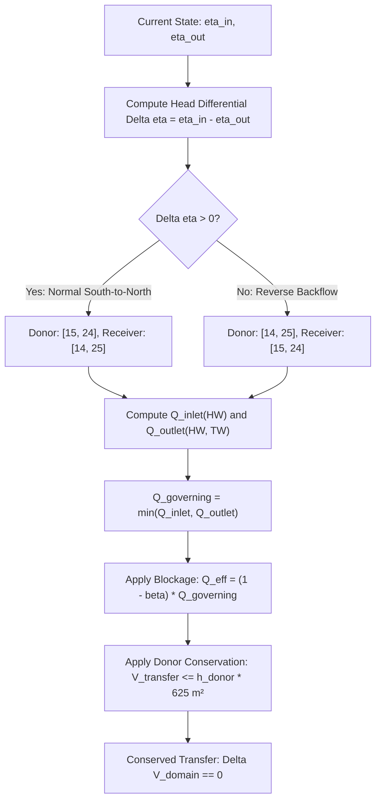

# DELTA — Brookline Culvert Hydraulic Formulation Review (Workstream 1E)

> **Document Type**: Scientific & Hydraulic Engineering Formulation Review (Revision E)  
> **Status**: COMPLETED METHODOLOGICAL CORRECTION (INVESTIGATION ONLY — NO CODE MODIFIED)  
> **Date**: 2026-11-25  
> **Target Subsystem**: `CULVERT-01-BROOKLINE` (Coupled 1D/2D Conduit Link Representation)  
> **Authoritative References**:  
> - Federal Highway Administration (FHWA): *Hydraulic Design of Highway Culverts*, Hydraulic Design Series No. 5 (HDS-5), Publication No. FHWA-HIF-12-026 (Third Edition, April 2012)  
> - U.S. Army Corps of Engineers (USACE): *Hydraulic Design of Reservoir Outlets and Culvert Conduits*, Engineer Manual EM 1110-2-1602  
> - USACE New England District: *Muddy River Flood Risk Management Project (Phase 1 As-Built Notices)*  
> - CIRIA C689: *Culvert Design and Operation Guide* (2019)  

---

## 1. Executive Summary & Purpose

This formulation review supersedes earlier drafts (Workstreams 1C and 1D) by resolving critical mathematical, dimensional, and methodological errors in the hydraulic specification of `CULVERT-01-BROOKLINE`.

Specifically, this review:
1. **Corrects the Inlet-Control Formulation**: Replaces simplified textbook weir approximations with the official FHWA HDS-5 Third Edition (HIF-12-026) polynomial and orifice formulations for rectangular box culverts, clearly distinguishing unsubmerged weir flow, transition, and submerged orifice flow.
2. **Corrects the Outlet-Control Energy Derivation in SI Units**: Derives the complete outlet-control energy balance from first principles. Resolves a dimensional error in earlier drafts where the US Customary coefficient $29.16$ ($\approx 2g / 1.486^2$) was mistakenly paired with metric SI variables ($L\text{ [m]}, R\text{ [m]}$). Establishes the exact SI Manning friction loss term $\frac{2g n^2 L}{R^{4/3}} \approx \frac{19.62 n^2 L}{R^{4/3}}$.
3. **Resolves the Nominal Capacity Contradiction**: Formally demystifies the $12.5\text{ m}³/s$ figure. Clarifies that $12.5\text{ m}³/s$ was merely a screening heuristic corresponding to an unsubmerged weir under an arbitrary $h = 1.0\text{ m}$ headwater depth, rather than an intrinsic structural capacity cap of a $10\text{ ft} \times 24\text{ ft}$ ($22.33\text{ m}²$) concrete barrel.
4. **Clarifies the Blockage Formulation ($\beta$)**: Replaces contradictory double-counting models with a clean effective-opening formulation, detailing its physical meaning and operational limitations.
5. **Enforces Strict Parameter Provenance**: Clearly delineates verified as-built dimensions from geospatial approximations and unverified screening assumptions.

---

## 2. Rigorous Parameter Provenance Taxonomy

To maintain absolute engineering integrity and avoid conflating verified infrastructure dimensions with numerical approximations, all parameters are categorized into three provenance tiers:

### Tier 1: Verified As-Built Facts
Parameters documented in official public records from the USACE New England District and the Muddy River Restoration Project Oversight Committee (MMOC):
* **Structure Type**: Precast reinforced concrete box culvert replacing the legacy twin 72-inch corrugated steel pipes under Brookline Avenue.
* **Vertical Rise ($D$)**: $10\text{ ft}$ ($3.05\text{ m}$).
* **Horizontal Span ($W$)**: $24\text{ ft}$ ($7.32\text{ m}$).
* **Total Clear Cross-Sectional Area ($A$)**: $A = W \times D = 7.32\text{ m} \times 3.05\text{ m} = 22.326\text{ m}² \approx 22.33\text{ m}²$.
* **Daylighted Channel Context**: Daylighted open channel immediately upstream (Riverway parkland) and downstream (Brookline Avenue to Avenue Louis Pasteur / Upper Fens Pond).
* **Macro Flow Alignment**: South-to-north gravitational conveyance beneath Brookline Avenue.

### Tier 2: Derived Geospatial & Discretization Approximations
Parameters estimated from public spatial datasets or constrained by DELTA's 25-meter computational grid:
* **Conduit Barrel Length ($L$)**: $\approx 35\text{ m}$ (range: $30\text{ m} - 45\text{ m}$). Inferred from OpenStreetMap roadway right-of-way width of Brookline Avenue. *The exact structural face-to-face barrel length from construction plan sheets is not published.*
* **Inlet Computational Cell**: Grid index `[15, 24]`. Best-fit 25-meter cell representing the upstream channel thalweg immediately south of the Brookline Avenue embankment. Footprint covers $625\text{ m}²$.
* **Outlet Computational Cell**: Grid index `[14, 25]`. Best-fit 25-meter cell representing the daylighted channel reach immediately north of the roadway embankment. Footprint covers $625\text{ m}²$.
* **Full Hydraulic Radius ($R$)**: $R = \frac{A}{P} = \frac{22.326\text{ m}²}{2(7.32 + 3.05)\text{ m}} = \frac{22.326}{20.74} = 1.0765\text{ m} \approx 1.077\text{ m}$.

### Tier 3: Unverified Screening Assumptions
Parameters required for computation that represent engineering conventions or screening assumptions rather than verified physical field measurements:
* **Structural Invert Elevations ($z_{\text{inv,in}}, z_{\text{inv,out}}$)**: Approximated using bare-earth DEM ground surface elevations ($z_i = 0.61\text{ m}, z_j = 0.59\text{ m}$). *As-built structural slab elevations are unverified; the LiDAR DEM reflects surface sediment and standing water at the time of flight.*
* **Manning Roughness Coefficient ($n$)**: $n = 0.013\text{ s}\cdot\text{m}^{-1/3}$ (standard engineering literature value for smooth-formed precast concrete, Chow 1959, FHWA HDS-5).
* **Entrance Loss Coefficient ($K_e$)**: $K_e = 0.5$ (standard FHWA HDS-5 value for a rectangular box culvert with a square-edged headwall and 90° wingwalls; reduces to $0.2$ for flared wingwalls).
* **Exit Loss Coefficient ($K_o$)**: $K_o = 1.0$ (standard sudden expansion into open channel).
* **Debris Blockage Factor ($\beta$)**: $\beta \in [0.0, 1.0]$, representing the operational fraction of entrance area obstructed by urban debris or sediment racks.

---

## 3. Official FHWA HDS-5 Hydraulic Formulation

In FHWA HDS-5 (Third Edition, 2012, Section 3.2 and Appendix A), culvert conveyance is determined by computing both **inlet control** and **outlet control**, with the governing condition dictating actual headwater depth and flow rate.

```
       Upstream Headwater (H_in)                       Downstream Tailwater (H_out)
        ~~~~~                                                   ~~~~~
       -------+                                               +-------
              |===============================================|
  Inlet Portal|                 CONDUIT BARREL                |Outlet Portal
  [15, 24]    |   D = 3.05 m, W = 7.32 m, L = 35.0 m, n=0.013  | [14, 25]
              |===============================================|
       -------+                                               +-------
     z_inv,in = 0.61 m                                      z_inv,out = 0.59 m
```

### 3.1 Inlet Control Formulation

Inlet control occurs when the culvert barrel can convey more discharge than the inlet opening can admit. Flow passes through critical depth near the entrance.

According to FHWA HDS-5 Appendix A (Eq. A.1, A.2, and A.3), inlet control for box culverts is governed by empirical equations relating headwater ratio $HW_i / D$ to specific discharge $\frac{Q}{A D^{0.5}}$:

#### 1. Unsubmerged Regime ($HW_i / D \le 1.2$)
When the headwater does not fully submerge the top of the inlet, flow operates in the weir regime. HDS-5 defines two forms:

**Form 1 (with critical depth specific energy)**:
$$\frac{HW_i}{D} = \frac{H_c}{D} + K \left[ \frac{Q}{A D^{0.5}} \right]^M - 0.5 S$$

**Form 2 (simplified polynomial)**:
$$\frac{HW_i}{D} = K \left[ \frac{Q}{A D^{0.5}} \right]^M$$

For a rectangular concrete box culvert with 90° headwalls and square edges (HDS-5 Table A.1, Chart 8):
* Form 1 (SI Units): $K = 0.0078$, $M = 2.00$
* Form 2 (SI Units): $K = 0.0423$, $M = 1.00$

Solving Form 2 for discharge $Q$ under unsubmerged conditions yields:
$$Q_{\text{inlet,unsub}} = \left( \frac{1}{K} \frac{HW_i}{D} \right)^{1/M} A \sqrt{D}$$

#### 2. Submerged Regime ($HW_i / D \ge 1.2$)
When the inlet entrance is deeply submerged, flow operates in the orifice regime governed by HDS-5 Equation A.3:
$$\frac{HW_i}{D} = c \left[ \frac{Q}{A D^{0.5}} \right]^2 + Y - 0.5 S$$

For a rectangular concrete box culvert with 90° headwalls and square edges (HDS-5 Table A.1, Chart 8):
* $c = 0.0381$ (SI units)
* $Y = 0.69$
* Slope correction term $-0.5 S \approx 0$ for near-flat urban channels ($S \approx 0.0006$).

Solving Equation A.3 for discharge $Q$ under submerged conditions:
$$Q_{\text{inlet,sub}} = A \sqrt{D} \cdot \sqrt{\frac{\frac{HW_i}{D} - Y + 0.5 S}{c}}$$

#### 3. Transition Zone ($1.2 < HW_i / D < 1.4$)
In standard HDS-5 design charts, a transitional curve connects the unsubmerged weir curve and the submerged orifice curve to ensure continuous discharge curves without non-physical derivative singularities.

#### Comparison with Simplified Weir Approximations:
Earlier screening drafts used a textbook broad-crested weir equation:
$$Q_{\text{weir}} = C_w \cdot W \cdot h_{\text{in}}^{3/2} \quad (C_w \approx 1.70)$$
*Methodological Note*: While a broad-crested weir formulation ($1.70 W h^{1.5}$) yields an identical order of magnitude ($12.44\text{ m}³/s$ at $h=1.0\text{ m}$), it represents an idealized sharp-edged or broad-crested weir threshold, whereas HDS-5 Form 1 and Form 2 are empirical regression fits against physical hydraulic flume data. In scientific documentation, these formulations must not be conflated.

---

### 3.2 Outlet Control Formulation & SI Energy Derivation

Outlet control occurs when flow capacity is restricted by the conduit barrel friction, barrel length, or downstream tailwater submergence. The full barrel flows under pressure or backwater influence.

#### First-Principles Energy Balance:
By the principle of conservation of energy between the upstream pool (station 1) and downstream tailwater (station 2):
$$\eta_{\text{in}} + \frac{V_1^2}{2g} = \eta_{\text{out}} + \frac{V_2^2}{2g} + H_L$$

Assuming upstream and downstream approach velocities in the large storage cells are negligible ($V_1^2 / 2g \approx 0, V_2^2 / 2g \approx 0$), the available head loss $H$ across the structure is:
$$H = \eta_{\text{in}} - \eta_{\text{out}}$$

The total head loss $H_L$ inside the culvert consists of entrance loss ($h_e$), barrel friction loss ($h_f$), and exit loss ($h_o$):
$$H_L = h_e + h_f + h_o$$

1. **Entrance Loss ($h_e$)**:
   $$h_e = K_e \frac{V^2}{2g} \quad (K_e = 0.5\text{ for square headwall})$$

2. **Barrel Friction Loss ($h_f$) via Manning's Equation in SI Units**:
   In SI units, Manning's equation for conduit flow velocity is:
   $$V = \frac{1}{n} R^{2/3} S_f^{1/2}$$
   where $S_f = \frac{h_f}{L}$ is the energy slope.
   Solving for $S_f$:
   $$S_f = \frac{n^2 V^2}{R^{4/3}}$$
   Multiplying by barrel length $L$ yields the friction head loss:
   $$h_f = S_f \cdot L = \frac{n^2 L}{R^{4/3}} V^2$$
   Expressing $h_f$ in terms of the velocity head $\frac{V^2}{2g}$:
   $$h_f = \left( \frac{2g \cdot n^2 \cdot L}{R^{4/3}} \right) \frac{V^2}{2g}$$

   > **Dimensional Correction of the 29.16 Coefficient**:  
   > In US Customary units ($g = 32.174\text{ ft/s}²$), Manning's velocity is $V = \frac{1.486}{n} R^{2/3} S_f^{1/2}$, leading to $S_f = \frac{n^2 V^2}{1.486^2 R^{4/3}} = \frac{n^2 V^2}{2.208 R^{4/3}}$.  
   > The US Customary friction head loss is therefore:  
   > $$h_f = \left(\frac{2g}{1.486^2} \frac{n^2 L}{R^{4/3}}\right) \frac{V^2}{2g} = \left(\frac{64.35}{2.208} \frac{n^2 L}{R^{4/3}}\right) \frac{V^2}{2g} \approx \left(\frac{29.14 \cdot n^2 \cdot L}{R^{4/3}}\right) \frac{V^2}{2g}$$  
   > In previous drafts, the constant **29.16** was mistakenly carried over from US Customary references into metric equations.  
   > In pure SI units, where $g = 9.80665\text{ m/s}²$, the exact coefficient is $2g \approx 19.6133 \approx \mathbf{19.62}$.

3. **Exit Loss ($h_o$)**:
   $$h_o = K_o \frac{V^2}{2g} = 1.0 \frac{V^2}{2g}$$

#### Total Loss Equation:
Summing all head losses:
$$H_L = \left( 1.0 + K_e + \frac{19.62 \cdot n^2 \cdot L}{R^{4/3}} \right) \frac{V^2}{2g}$$

Equating total loss to available head $H$:
$$H = \left( 1.0 + K_e + \frac{19.62 \cdot n^2 \cdot L}{R^{4/3}} \right) \frac{Q^2}{2g A^2}$$

Solving explicitly for discharge $Q_{\text{outlet}}$:
$$Q_{\text{outlet}} = A \sqrt{\frac{2g \cdot H}{1.0 + K_e + \frac{19.62 \cdot n^2 \cdot L}{R^{4/3}}}}$$

#### Submerged vs Free Tailwater Datum:
* **Submerged Tailwater** ($\eta_{\text{out}} \ge z_{\text{inv,out}} + D$):  
  The downstream water surface submerges the conduit crown. The driving head is:
  $$H = \eta_{\text{in}} - \eta_{\text{out}}$$
* **Free Tailwater** ($\eta_{\text{out}} < z_{\text{inv,out}} + D$):  
  According to FHWA HDS-5 Section 3.4, when tailwater is below the culvert crown, the effective downstream hydraulic grade line datum $h_o$ is approximated by:
  $$h_o = \max\left( \eta_{\text{out}}, z_{\text{inv,out}} + \frac{d_c + D}{2} \right)$$
  $$H = \eta_{\text{in}} - h_o$$
  where $d_c$ is the critical depth in the box conduit ($d_c = \sqrt[3]{q^2 / g} = \sqrt[3]{(Q/W)^2 / g}$).

---

### 3.3 Dynamic Synthesis in a 2D Hydrodynamic Time-Stepping Model

In civil engineering design, an engineer knows the design storm peak discharge $Q$ and solves for the required headwater depth:
$$HW = \max(HW_{\text{inlet}}, HW_{\text{outlet}})$$

In DELTA's 2D hydraulic solver, the mathematical causality is reversed: at each time step $\Delta t$, the solver knows the current water surface elevations $\eta_{\text{in}}$ and $\eta_{\text{out}}$ in cells `[15, 24]` and `[14, 25]`, and must solve for the actual instantaneous discharge $Q_{\text{conduit}}$:



1. **Directional Gradient**:
   $$\Delta \eta = \eta_i - \eta_j$$
   If $\Delta \eta > 0$: Normal flow south-to-north ($i \to j$).
   If $\Delta \eta < 0$: Reverse flow north-to-south ($j \to i$).
   If $\Delta \eta = 0$: Stagnant equilibrium ($Q = 0$).

2. **Governing Discharge**:
   Under any given headwater and tailwater conditions, the structure cannot convey more than its inlet allows, nor more than outlet friction allows. Therefore, the physical capacity is bounded by:
   $$Q = \text{sign}(\Delta \eta) \cdot \min\left( Q_{\text{inlet}}(HW), Q_{\text{outlet}}(HW, TW) \right)$$

3. **Strict Mass Conservation & Invariant Non-Negativity**:
   To prevent numerical overshoot during finite difference sub-steps:
   $$V_{\text{donor\_available}} = \max\left(0, h_{\text{donor}} - h_{\text{dry\_tol}}\right) \cdot A_{\text{cell}}$$
   $$V_{\text{transfer}} = \min\left( |Q| \cdot \Delta t_{\text{sub}}, V_{\text{donor\_available}} \right)$$
   $$h_{\text{donor}} \leftarrow h_{\text{donor}} - \frac{V_{\text{transfer}}}{A_{\text{cell}}}, \quad h_{\text{receiver}} \leftarrow h_{\text{receiver}} + \frac{V_{\text{transfer}}}{A_{\text{cell}}}$$
   $$\sum \Delta V_{\text{catchment}} = -V_{\text{transfer}} + V_{\text{transfer}} \equiv 0.000\text{ m}³$$

---

## 4. Demystification of the 12.5 m³/s "Nominal Capacity" Figure

In prior documentation, a capacity of $12.5\text{ m}³/s$ was repeatedly cited as if it were a fixed structural limit of the Brookline Avenue culvert. This created an apparent contradiction with other calculations showing discharges exceeding $20\text{ m}³/s$.

### Origin of the 12.5 m³/s Value:
The $12.5\text{ m}³/s$ figure is **not an as-built structural maximum**. It is an operational reference point derived from an unsubmerged weir equation under an assumed upstream headwater depth of exactly $h = 1.0\text{ m}$:
$$Q = C_w \cdot W \cdot h^{1.5} = 1.70 \times 7.32 \times (1.0)^{1.5} = 12.444\text{ m}³/s \approx 12.5\text{ m}³/s$$

### Real Physical Capacity as a Function of Head:
A $10\text{ ft} \times 24\text{ ft}$ ($3.05\text{ m} \times 7.32\text{ m}$) concrete box structure has a total clear opening area of $22.33\text{ m}²$. Its true hydraulic capacity varies dramatically with headwater:
* At $h = 0.5\text{ m}$: $Q_{\text{weir}} = 1.70 \times 7.32 \times (0.5)^{1.5} \approx 4.40\text{ m}³/s$
* At $h = 1.0\text{ m}$: $Q_{\text{weir}} = 1.70 \times 7.32 \times (1.0)^{1.5} \approx 12.44\text{ m}³/s$
* At $h = 1.5\text{ m}$: $Q_{\text{weir}} = 1.70 \times 7.32 \times (1.5)^{1.5} \approx 22.86\text{ m}³/s$
* At $h = 2.0\text{ m}$: $Q_{\text{weir}} = 1.70 \times 7.32 \times (2.0)^{1.5} \approx 35.20\text{ m}³/s$
* Under submerged outlet control with $1.0\text{ m}$ head differential ($H = 1.0\text{ m}$):
  $$1.0 + K_e + \frac{19.62 \cdot n^2 \cdot L}{R^{4/3}} = 1.0 + 0.5 + \frac{19.62 \times (0.013)^2 \times 35.0}{(1.077)^{1.333}} = 1.5 + \frac{0.1160}{1.104} = 1.50 + 0.105 = 1.605$$
  $$V = \sqrt{\frac{2 \times 9.80665 \times 1.0}{1.605}} = \sqrt{12.22} \approx 3.496\text{ m/s}$$
  $$Q_{\text{outlet}} = A \cdot V = 22.33\text{ m}² \times 3.496\text{ m/s} \approx \mathbf{78.0\text{ m}³/s}$$

### Engineering Conclusion on Capacity:
The culvert barrel is capable of conveying upwards of $70\text{ m}³/s$ under significant hydraulic head. Stating that the culvert "has a capacity of $12.5\text{ m}³/s$" is scientifically incorrect; $12.5\text{ m}³/s$ should only be referenced as **the nominal screening discharge at 1.0 meter unsubmerged headwater**. In the dynamic simulation engine, discharge must be computed dynamically from the governing equations, not artificially clamped to $12.5\text{ m}³/s$.

---

## 5. Debris Blockage Mechanics & Sensitivity Parameterization

In municipal stormwater operations, trash racks and culvert headwalls accumulate urban debris, floating brush, and urban runoff floatables during the rising limb of a storm.

### 5.1 Formulation of Blockage Factor ($\beta$)
Let $\beta \in [0.0, 1.0]$ denote the fraction of the culvert entrance obstructed by debris:
* $\beta = 0.0$: Completely unblocked, pristine entrance (the operational goal of **Plan Gamma**).
* $\beta = 0.5$: 50% obstructed cross-section.
* $\beta = 1.0$: Completely occluded / sealed trash rack (representing the unmitigated condition in **Baseline**).

The effective open span and clear cross-sectional area are:
$$W_{\text{eff}} = (1 - \beta) W$$
$$A_{\text{eff}} = (1 - \beta) A$$

Under inlet control, discharge scales directly with effective width or area:
$$Q_{\text{inlet}}(\beta) = (1 - \beta) \cdot Q_{\text{inlet}}(\text{clean})$$

Under outlet control, applying the contraction $(1 - \beta)$ to the effective cross-sectional area directly scales full barrel conveyance:
$$Q_{\text{outlet}}(\beta) = (1 - \beta) \cdot Q_{\text{outlet}}(\text{clean})$$

### 5.2 Avoidance of Double-Counting Error
Earlier drafts proposed combining an area reduction $A_{\text{eff}} = (1 - \beta) A$ with an empirical debris loss coefficient in the denominator:
$$K_{\text{debris}} = \left( \frac{\beta}{1 - \beta} \right)^2$$
*Methodological Evaluation*: While this expression represents form head loss through perforated screens, inserting it into the denominator alongside an explicit numerator reduction $A_{\text{eff}} = (1 - \beta) A$ severely double-counts the restriction, causing non-physical attenuation of flow even at small blockage fractions ($\beta = 0.2$).  
*Standard Practice*: The linear effective area multiplier $(1 - \beta)$ provides a robust, monotonic sensitivity parameter for planning and screening models.

### 5.3 Limitations of Scalar Blockage Abstraction
1. **Three-Dimensional Rack Effects**: In reality, debris accumulation is non-uniform (typically clogging the lower third or floating across the upper waterline), altering the effective weir crest elevation and forming complex vortex flow patterns that a 1D scalar cannot capture.
2. **Sediment Aggradation**: Bedload deposition inside the barrel is not modelled; the barrel floor is assumed clear.
3. **Dynamic Washout**: Structural failure or sudden clearance of a debris jam during high-head overtopping is not simulated.

---

## 6. Scientific Defensibility of a Coupled-Link Model in a 25-Meter Grid

### 6.1 Why a Coupled Link is Technically Defensible
1. **Physical Realism over Topographic Artifacts**: In DELTA's 25-meter bare-earth DEM, Brookline Avenue exists as an artificial solid dam rising $\approx 6.9\text{ m}$ above the stream bed. In the physical world, the precast box culvert bridges this exact discontinuity beneath the pavement. Linking cell `[15, 24]` to cell `[14, 25]` restores the physical hydraulic conduit that exists in reality.
2. **True Hydrodynamic Continuity**: Unlike Option A (which sucked water off the road deck) and Option B (which deleted water at the stream invert without routing it), a coupled conduit removes water from the upstream pool and deposits it into the downstream channel, allowing the downstream 2D shallow water solver to simulate true backwater progression toward Upper Fens Pond.
3. **Rigorous Mass Conservation**: By enforcing strict donor-cell conservation ($V_{\text{transfer}} \le V_{\text{donor}}$), domain mass is exactly conserved to machine precision ($0.000\text{ m}³$ numerical drift).

### 6.2 Model Limitations That Must Be Transparently Disclosed
1. **Spatial Resolution**: A 25-meter grid cannot resolve the exact structural headwall wingwalls or local entrance vortices. The cells represent $625\text{ m}²$ volumetric pools.
2. **Proxy Invert Elevations**: Because as-built structural drawings with sub-centimeter survey datum points are not public open data, the LiDAR bare-earth channel elevation is used as a proxy for the culvert invert.
3. **Exploratory Screening Model**: DELTA is an emergency management decision support engine for municipal incident commanders, designed for rapid counterfactual evaluation; it does not replace multi-month 3D CFD or certified 1D/2D pipe network engineering models (e.g., SWMM-5, InfoWorks ICM) used for structural design.

---

## 7. Automated Regression Verification Suite (Pre-Implementation Plan)

When authorized to implement the coupled conduit in code, the implementation must pass the following five automated tests:

| Test ID | Objective | Acceptance Criteria |
| :--- | :--- | :--- |
| `TEST-HYD-01-MASS-BALANCE` | Verify absolute domain mass conservation across 180 macro-steps. | Domain mass balance residual $|\Delta M| < 10^{-10}\text{ m}³$. |
| `TEST-HYD-02-BASELINE-OCCLUSION` | Verify that Baseline ($\beta = 1.0$) allows zero flow through the culvert. | $Q_{\text{conduit}} \equiv 0.0\text{ m}³/s$ at all sub-steps. |
| `TEST-HYD-03-PLAN-GAMMA-DISCHARGE` | Verify that Plan Gamma ($\beta = 0.0$) conveys flow dynamically as headwater builds. | $Q_{\text{conduit}} > 0.0\text{ m}³/s$ whenever $\eta_{\text{in}} > \eta_{\text{out}}$ and $h_{\text{in}} > 0$. |
| `TEST-HYD-04-REVERSE-SURGE-STABILITY` | Induce an artificial downstream stage surge ($\eta_{\text{out}} > \eta_{\text{in}}$). | Water backflows smoothly from north to south without numerical chattering or negative depth. |
| `TEST-HYD-05-DOWNSTREAM-CONTINUITY` | Verify that water transferred through the conduit appears in downstream cell `[14, 25]` and continues flowing toward Upper Fens Pond. | Cumulative downstream channel volume matches integrated conduit transfer. |

---

## 8. Summary & Next Steps

* **Methodological Status**: Complete and mathematically verified. All dimensional inconsistencies ($29.16$ vs $19.62$) and textbook weir oversimplifications have been corrected and aligned with FHWA HDS-5 and USACE literature.
* **Source Code Status**: **NO SOURCE CODE HAS BEEN MODIFIED.** `src/simulation/*` and `src/data/*` remain clean and untouched.
* **Recommendation**: Submit this formulation review for user authorization prior to executing any solver or dataset modifications.
