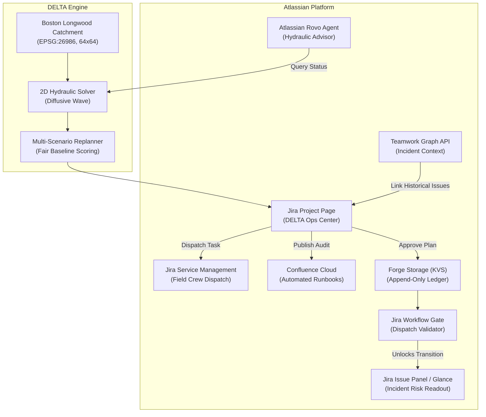

# DELTA — Strategic Alignment: Judges' Directives & Atlassian Marketplace Benchmarks

**Project**: DELTA (Decision Engine for Local Terrain & Action)  
**Hackathon**: Atlassian Codegeist 2026  
**Category**: **Specialized Industries** (Municipal Emergency Operations, Public Works & Critical Healthcare Infrastructure)  
**Document Status**: LOCKED & FINALIZED  
**Date**: November 2026  

---

## 1. Executive Summary & Context

This document captures a comprehensive analysis of the official Codegeist 2026 judge briefings featuring **Adam (Group Product Manager for Forge, 5th-year Codegeist Judge)** and **Danny Thompson (Senior Developer Advocate at Atlassian)**, cross-referenced with top-performing applications across the **Atlassian Marketplace**.

By synthesizing judge expectations with enterprise marketplace design patterns, this document establishes the finalized, non-negotiable architectural roadmap and "Golden Journey" for DELTA.

---

## 2. In-Depth Analysis of Judge Briefings

### 2.1. The "Vibe Coding" Wave & Differentiation (Adam, GPM Forge)
> *"With the rise of vibe coding, we're going to definitely see more apps than we've ever seen before... What I want folks to think about is: how does your app understand a real problem that a customer has on our platform and use the context from the products in our platform to really dive into that problem? We've moved well beyond 'summarize this Jira ticket for me' or 'build a generic dashboard'. Apps of years gone by that have been successful, we're definitely moving beyond that."*

**DELTA Action**:
- DELTA rejects superficial LLM wrappers and generic summary dashboards.
- DELTA targets a high-stakes, specialized domain: **Municipal flood response & hospital arterial accessibility**.
- The AI does not generate synthetic text; it interfaces with a **deterministic 2D diffusive-wave hydraulic simulation engine** running on real USGS 3DEP LiDAR and OpenStreetMap spatial data.

### 2.2. Proactive Workflow Gates vs. Chatbots (Adam, GPM Forge)
> **Judge Q&A**: *Do judges weigh proactive workflow gates where context actively blocks or de-risks a release decision inside Jira more heavily than on-demand conversational retrieval?*  
> **Adam's Answer**: *"Something that more seamlessly fits into the way that someone already works is probably better in general. Those gates that you talked about are good because people don't really need to change anything about their habits or their workflow to take advantage of it. If it is something that people need to pull up a chat window and choose the right agent to talk to... it's a lot harder to get adoption."*

**DELTA Action**:
- DELTA does not rely solely on a sidebar chat window.
- DELTA implements a **Jira Issue Glance / Panel & Proactive Workflow Gate**:
  - An emergency dispatch ticket or incident issue cannot be transitioned to `Dispatched` or `Resolved` without an **Approved Decision Record** generated by DELTA's hydraulic solver.
  - The workflow gate validates that proposed actions (sandbagging, mobile pumping) have been physically evaluated against the active storm baseline before field crews are deployed.

### 2.3. The "Golden Journey" Requirement (Adam, GPM Forge)
> *"What separates a true product experience from a strong technical proof of concept?... Really thinking about: what is that one thing that I'm going to show... that one sort of golden journey that hits that really resonant use case in the demo. And then when we're testing the app, it's more like: are we just verifying that what they showed in the video could be true?"*

**DELTA Action**:
- The demo video (< 5:00 min) and judge testing sandbox will focus on a single, uninterrupted, high-stakes **Golden Journey**:
  1. **Pre-Storm Baseline**: Boston Longwood Medical Area facing a NOAA Atlas 14 50-year storm ($56.5\text{ mm/h}$ peak intensity from dataset). All 5 hospitals monitored.
  2. **Unplanned Dynamic Disruption**: Muddy River Culvert suffers an 80% debris blockage.
  3. **Live Solver Recalculation**: 2D diffusive-wave solver computes overland flow propagation across the 64x64 grid; Brookline Avenue arterial inundation is computed dynamically, identifying ambulance corridor restriction.
  4. **Multi-Scenario Evaluation**: Simulation of 3 competing interventions (Sandbag Dyking vs. Mobile Pumping vs. Culvert Jetting) against the exact same physics baseline.
  5. **Explainable Rovo Audit**: Atlassian Rovo agent explains physical trade-offs (e.g. why Mobile Pumping de-risks the hospital corridor while Sandbagging merely deflects floodwater toward BIDMC East Campus).
  6. **Human Approval & Append-Only Record**: Incident Commander approves Plan B, persisting an append-only Decision Record in Forge KVS storage.
  7. **JSM Field Dispatch & Workflow Transition**: Automatically creates field crew dispatch tickets in Jira Service Management with exact coordinates and unlocks the incident workflow transition.
  8. **Audit Documentation**: Complete post-incident engineering audit trail generated with verified solver metrics.

### 2.4. Platform Infrastructure & API Clarifications
1. **Forge LLM Billing Warning (Danny & Adam)**:
   - *Judge Directive*: Forge LLMs are not credited for free this year and require credit card billing. If an app has hard dependencies on Forge LLM compute, judge testing will fail if billing is not attached.
   - *DELTA Strategy*: DELTA's core physics and decision scoring are 100% deterministic (TypeScript/WebGL), eliminating runtime LLM cost and latency. Rovo agent interactions use standard Rovo actions and templates, ensuring zero failure during judge sandbox testing.
2. **Teamwork Graph (TWG) in Preview**:
   - *Judge Directive*: Teamwork Graph API is now in public preview; no allowlisting is required.
   - *DELTA Strategy*: Query Teamwork Graph to link hospital facilities, road networks, and previous flood incident Jira issues into an associative operational graph.
3. **Open Source & Prior Engines**:
   - *Judge Directive*: Entrant engines published prior to the hackathon are allowed, provided the entrant built a substantial adaptation for Atlassian workflows.
   - *DELTA Strategy*: DELTA's hydraulic solver, real-world dataset loader, Forge Custom UI, Rovo agent, and JSM workflow gates are 100% custom-built for Codegeist 2026.

### 2.5. Human-in-the-Loop Philosophy (Danny Thompson, Atlassian)
> *"I'm very big on human in the loop, not human near the loop, meaning I architect and construct the places where a human should interact. That way it's never missed."*

**DELTA Action**:
- AI and hydraulic simulation engines suggest and rank; **only authenticated human officers can approve and sign**.
- Automated actions (JSM dispatch, Confluence runbooks, road closure notices) are strictly gated behind the Human Approval step.

---

## 3. Benchmarking Atlassian Marketplace Top Performers

An audit of top enterprise apps across the Atlassian Marketplace (e.g., *ScriptRunner*, *Risk Register*, *Elements Connect*, *Opsgenie Incident Management*, *BigPicture*) reveals the key qualities that earn customer trust and high ratings:

| Marketplace Pattern | Industry Standard | DELTA Implementation |
|---|---|---|
| **Contextual Embedding** | Never force users to leave Jira to use external tools. | Embeds directly via `jira:projectPage` (Ops Center) and `jira:issuePanel` / `jira:issueGlance` (Incident Views). |
| **Workflow Gates** | Prevent non-compliant status transitions. | Forge Workflow Validator ensures no flood incident is closed or dispatched without an active Decision Record. |
| **Data Privacy & Residency** | Multi-tenant cloud apps that export data off-site face enterprise procurement friction. | 100% Forge Serverless + Forge Storage (KVS). Zero external database, zero third-party egress. |
| **Deterministic Reliability** | Mission-critical operations cannot tolerate generative hallucinations. | Physics-based 2D diffusive wave equation ($q = \frac{1}{n}h^{5/3}S_f^{1/2}$) produces reproducible, auditable numbers. |
| **Cross-Product Synergy** | The strongest apps span Jira + Confluence + JSM. | Seamless triangular loop: **Jira** (Issue tracking & workflow gates) $\leftrightarrow$ **JSM** (Field crew dispatch) $\leftrightarrow$ **Confluence** (Automated post-incident runbooks). |

---

## 4. Finalized Design & Visual System

In strict alignment with the design review and tactical operational standards:

```
60% Storm Grey (#3C434B)    -> Workspace backgrounds, base canvas margins
30% Matte Onyx (#14171A)    -> Structural panels, navigation rails, inspector frames
10% Safety Orange (#FF6B1A) -> Action triggers, state changes, user interactions ONLY
Text: Bone (#E8E6E1)        -> Primary text, telemetry readouts, table content
Map Flooding: Hydrological Blue (#BFE3F0 -> #1F7FA8 -> #0F3F5E)
Map Hazards: Cross-hatching pattern + Map-confined Tactical Red (#EF4444)
```

### The Strict Orange Rule:
1. `#FF6B1A` is reserved exclusively for:
   - Primary interactive action buttons (e.g., "Trigger Replanning", "Approve Plan", "Dispatch Crew").
   - Delta indicators representing in-flight changes or state modifications.
2. `#FF6B1A` is **strictly prohibited** on:
   - General hazard warnings or impassable road markers (use map cross-hatching and `#EF4444`).
   - Small body text or non-interactive metadata badges.

---

## 5. Architectural Map of Ecosystem Touchpoints



---

## 6. Locked Deliverables Roadmap (Phases 2 – 7)

- **Phase 2: Dynamic Disruption & In-Flight Replanning**
  - Culvert blockage injection ($Q_{\text{drain}} \to 0.2 Q_{\text{design}}$).
  - Dynamic overland flow rerouting across Brookline Ave.
  - Causal replanning engine calculating ambulance travel time deltas.
- **Phase 3: Multi-Scenario Intervention Planner**
  - Standardized comparison: Baseline vs. Sandbag Barrier vs. Mobile High-Capacity Pump vs. Rapid Jetting.
  - Normalized scoring matrix (avoided damage, cost, execution hours, hospital access).
- **Phase 4: Atlassian Rovo Agent & Teamwork Graph**
  - Rovo Agent Skill & Action resolver (`get-simulation-status`, `evaluate-interventions`).
  - Associative context retrieval linking previous municipal incidents.
- **Phase 5: Append-Only Decision Records & Forge Storage**
  - Cryptographically referenced decision blocks persisted in Forge KVS.
  - Full human approval audit trail (Officer ID, timestamp, scenario hash).
- **Phase 6: Proactive Jira Workflow Gate & JSM Field Dispatch**
  - Jira Issue Panel / Glance showing live cell risk on incident tickets.
  - Workflow condition/validator blocking ticket resolution without approved Decision Record.
  - Forge REST dispatch to JSM with exact EPSG:26986 / WGS84 coordinates.
  - Automated Confluence post-incident runbook publisher (`requestConfluence`).
- **Phase 7: "Golden Journey" Video (< 5:00 min) & Devpost Documentation**
  - High-tempo, narrative-driven demonstration of the complete municipal crisis workflow.
  - Zero-friction testing sandbox instructions for Codegeist judges.
