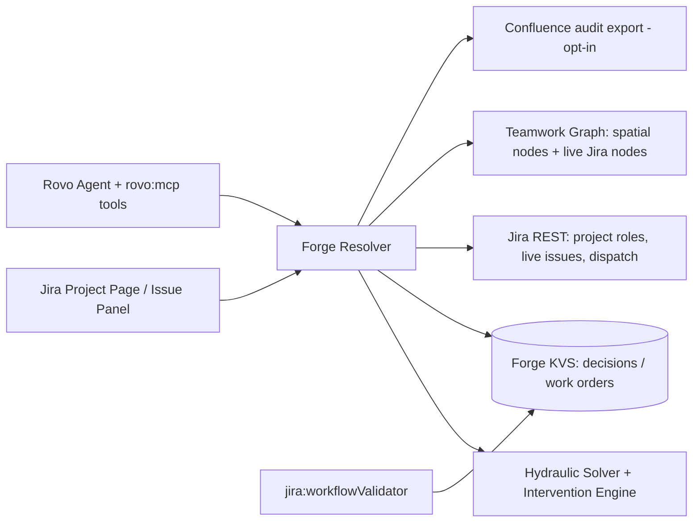

# DELTA — Deterministic Flood Decision & Dispatch for Jira

DELTA helps an Incident Commander answer, during a storm: *which intervention protects hospital access most, and can I prove and dispatch that decision?* It runs a deterministic 2D diffusive-wave hydraulic screening model (25 m cells, Boston Longwood / Muddy River catchment), ranks interventions from computed physics — never invented numbers — and records the human-approved decision immutably in Forge KVS before any field ticket exists.

## Architecture



- **Dynamic project scoping:** approvals, links, dispatch, and the workflow gate bind to the project from Forge invocation context (or the linked issue), not a hard-coded key.
- **Authorization:** primary role is Jira project role `Incident Commanders` (direct or verified-group membership). `Administrators` is a fallback only when that role is not configured on the project (fresh demo sites). All checks fail closed.
- **Live dispatch:** human-triggered only. A ticket counts as dispatched only when Jira returns a real issue key; the UI shows its clickable browse link. Nothing is fabricated outside Forge.
- **Audit:** Confluence export is an opt-in checkbox (OFF by default) on decision approval; the space key is optional/editable and otherwise the first available Confluence space is auto-discovered.

## Setup (judge demo site)

```bash
npm install
npm run build
forge deploy
forge install --demo-site   # or: forge install --site <your-site> --product jira
```

In the target project, optionally create a project role named `Incident Commanders` and assign commanders (directly or via a group). Without it, project `Administrators` can approve. Attach the **DELTA Decision Record Approval Gate** (`jira:workflowValidator`) to the *Dispatched/Resolved* transitions in the project workflow so transitions require an approved, project-bound decision record.

> Judges: toggle DELTA's MCP tools ON in app settings to use them from Rovo / an MCP client.

## Judge & Admin Setup (3 Minutes) — live-verified on one-atlas-xttm.atlassian.net
1. **Enable Rovo Agent Access**: Admin → **AI and Rovo → Agents → DELTA Hydraulic Advisor → Add to group** → add your Jira users group (e.g. `jira-users-<site>`). Required after install/major upgrade — with no group assigned the agent is invisible in Rovo Chat. Verified: agent reappears in the picker and runs live DELTA tool calls.
2. **Enable Atlassian MCP (`rovo:mcp`)**: Admin → **Connected Apps → delta-decision-engine → Tools** → toggle **Expose tools to MCP-compatible apps** ON. Then any MCP client (Copilot/Claude/Cursor) can call the tools in `mcp/SKILL.md`.
3. **Attach Proactive Workflow Gate**: Project Settings → **Workflows → Edit workflow → Done** transition (Any status) → **Validate details → Add rule → Marketplace Rules → DELTA Decision Record Approval Gate → Add → Update workflow**.
4. **Verify Full Gate (Block → Pass)**: move an unlinked flood issue to *Done* — it is blocked (HTTP 400, *"DELTA Gate Blocked: …cannot transition without an approved mitigation plan"*, verified live on PLAT-33511). Then in DELTA approve a Decision Record **linked to that exact issue key** and retry — the transition passes. The gate checks Forge KVS for an approved, project-bound record for that issue key only.

## Verify

```bash
npm run lint && npm test && npm run build && forge lint
```

## Championship upgrades (Codegeist 2026)
Full plan: `docs/competition/championship-upgrades.md`. In one line each:
1. **Click-Anywhere Sandbox** (Simulation screen): enable, pick Pump/Barrier/Blockage + strength + rainfall scale, click any cell — the real 2D solver recomputes and reports avoided volume + adverse cells (screening representation). Golden Journey is untouched unless you place an action.
2. **Proactive trigger + panel snapshot**: creating a flood/drainage Jira issue posts one deduped DELTA risk comment (honest `NO_RUN` if no run is stored); the issue panel shows a compact flood-impact snapshot with a deep link back to the DELTA Engine.
3. **Teamwork Graph + related context**: live Jira nodes plus best-effort Teamwork Graph / Confluence runbook / Compass context (`query-related-context`); unavailable sources report `*_UNAVAILABLE`, never fabricated nodes.
4. **Governance Settings + judge seed**: header **Settings** drawer (Forge KVS) with commander role, dispatch issue type, Confluence space, trigger toggle — and **Create Sample Flood Incident** for a 30-second fresh-site test.
5. **External `rovo:mcp` proof**: exact tool keys are in `mcp/SKILL.md`; `node scripts/verify-rovo-mcp.mjs` prints the 20-second external-agent (Copilot/Claude/Cursor) verification sequence to record for the demo video.

> Demo truth note: on the stored NOAA run the solver ranks **Plan Beta** first — the demo script follows the solver, and every number shown comes from a solver run or Forge KVS.
