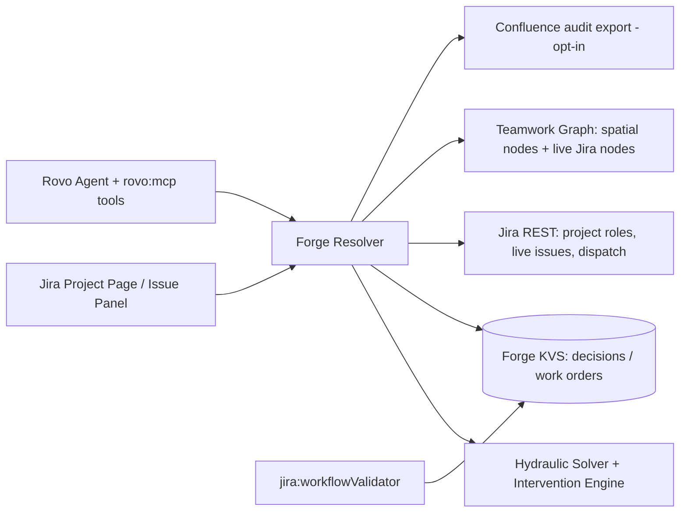

# DELTA — Deterministic Flood Decision & Dispatch for Jira

DELTA helps an Incident Commander answer, during a storm: *which intervention protects hospital access most, and can I prove and dispatch that decision?* It runs a deterministic 2D diffusive-wave hydraulic screening model (25 m cells, Boston Longwood / Muddy River catchment), ranks interventions from computed physics — never invented numbers — and records the human-approved decision immutably in Forge KVS before any field ticket exists.

## Architecture



- **Dynamic project scoping:** approvals, links, dispatch, and the workflow gate bind to the project from Forge invocation context (or the linked issue), not a hard-coded key.
- **Authorization:** primary role is Jira project role `Incident Commanders` (direct or verified-group membership). `Administrators` is a fallback only when that role is not configured on the project (fresh demo sites). All checks fail closed.
- **Live dispatch:** human-triggered only. A ticket counts as dispatched only when Jira returns a real issue key; the UI shows its clickable browse link. Nothing is fabricated outside Forge.
- **Audit:** Confluence export is an opt-in checkbox (OFF by default) on decision approval.

## Setup (judge demo site)

```bash
npm install
npm run build
forge deploy
forge install --demo-site   # or: forge install --site <your-site> --product jira
```

In the target project, optionally create a project role named `Incident Commanders` and assign commanders (directly or via a group). Without it, project `Administrators` can approve. Attach the **DELTA Decision Record Approval Gate** (`jira:workflowValidator`) to the *Dispatched/Resolved* transitions in the project workflow so transitions require an approved, project-bound decision record.

> Judges: toggle DELTA's MCP tools ON in app settings to use them from Rovo / an MCP client.

## Verify

```bash
npm run lint && npm test && npm run build && forge lint
```
