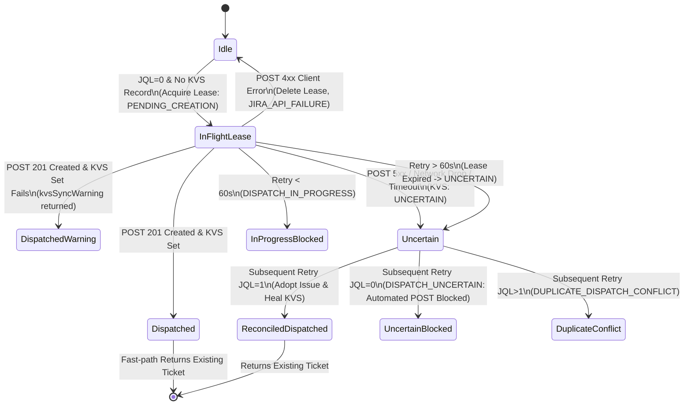

# DELTA — Task 0.7.1.4: Independent Security and Recovery Verification

> **Review Date**: 2026-11-25  
> **Audited Commit**: [`af067ff`](https://github.com/commit-to-Noma/DELTA/commit/af067ff) (`fix(security): complete Task 0.7.1.3 authorization hardening and dispatch fail-closed safety`)  
> **Review Scope**: STRICTLY READ-ONLY audit across Forge Identity Resolution, Server-Side Authorization Policy, Dispatch State Machine & Recovery Flows, KVS Concurrency Boundaries, Spatial Provenance, and Test Suite Quality.  
> **Audited Files**:
> - `manifest.yml`
> - `src/resolvers/authPolicy.js`
> - `src/resolvers/decisionStorage.js`
> - `src/resolvers/jsmDispatcher.js`
> - `src/resolvers/index.js`
> - `src/resolvers/coordinates.js`
> - `src/resolvers/workflowValidator.js`
> - `src/data/interventionSites.js`
> - `tests/jsmDispatcher.test.ts`
> - `tests/forgeResolver.test.ts`
> - `tests/workflowValidator.test.ts`
> - `TASK_0_7_1_3_REMEDIATION.md`
> - `TASK_0_7_1_2_INDEPENDENT_VERIFICATION.md`

---

## 1. Executive Verdict

### **VERDICT: PASS WITH CONDITIONS**
#### **Authorized for Phase 0.7.2 Limited KVS Smoke Test ONLY**
#### **STRICT PROHIBITION on Live JSM Ticket Dispatch & Live Workflow Validator Binding**

Commit `af067ff` successfully resolves all critical and high-severity security vulnerabilities identified in Task 0.7.1.2:
1. **Forge Identity**: All client-supplied identity fallbacks have been removed. User identity is strictly resolved from trusted Forge backend execution context (`req.context.accountId` / `principal.accountId`). Missing or malformed identities fail closed (`UNAUTHENTICATED_SESSION`).
2. **Authorization**: Operational project key is hard-pinned server-side to `EMERG` across all resolvers. The generic `Administrators` fallback is eliminated. Direct user assignment to the `Incident Commanders` project role is strictly verified; group role actors fail closed with diagnostic remediation advice.
3. **Dispatch Recovery & State Machine**: Expired leases (> 60s) transition to `UNCERTAIN` and never auto-proceed to POST. When state is `UNCERTAIN`, returning zero JQL results strictly blocks automated issue creation (`DISPATCH_UNCERTAIN`), eliminating the search-indexing lag duplicate trap. Ambiguous HTTP 502/503 and network disconnects are safely classified as `UNCERTAIN`.
4. **Spatial Provenance**: Plan Alpha coordinates are programmatically derived from the midpoint of OSM Way `1377084984` (Francis St) via lightweight module `src/data/interventionSites.js` without bundling the 1MB DEM into Forge backend resolvers. ADF descriptions explicitly designate the site as a *"Modelled Intervention Staging Point"*.

**Residual Limitation**: Forge KVS does not support atomic Compare-And-Swap (CAS) or conditional writes (`setIfNotExist`). The read-then-write lease sequence reduces the likelihood of duplicate creation but leaves a sub-second race window under simultaneous concurrent execution. Because live dispatch is held and disabled, this concurrency risk is contained.

---

## 2. Summary of Findings

| ID | Severity | Status | Category | Finding Summary | Exact File & Lines |
| :--- | :--- | :--- | :--- | :--- | :--- |
| **SEC-02** | **HIGH** | **RESOLVED** | Identity Integrity | Client-supplied identity fallbacks eradicated. Missing/unverified Forge backend context strictly fails closed with `UNAUTHENTICATED_SESSION`. | `src/resolvers/decisionStorage.js:115-137`<br>`src/resolvers/jsmDispatcher.js:184-192`<br>`src/resolvers/index.js:123, 131, 184` |
| **SEC-03** | **HIGH** | **RESOLVED** | Project Scoping | Operational project key locked server-side to `EMERG`. Client overrides throw `INVALID_PROJECT_SCOPE`. Role query URLs hardcoded to `EMERG`. | `src/resolvers/authPolicy.js:22, 48-53, 87`<br>`src/resolvers/decisionStorage.js:140-146`<br>`src/resolvers/jsmDispatcher.js:195-202` |
| **SEC-04** | **MEDIUM** | **RESOLVED** | Role Resolution | Removed `Administrators` fallback. Evaluates `atlassian-user-role-actor` direct user assignment. Group actors fail closed with `ROLE_ASSIGNMENT_GROUP_UNSUPPORTED`. | `src/resolvers/authPolicy.js:96-104, 128-150` |
| **IDEMP-03**| **CRITICAL**| **RESOLVED** | Search Lag Trap | Expired lease (> 60s) transitions to `UNCERTAIN`. 0-result JQL query when `UNCERTAIN` strictly blocks automated POST (`DISPATCH_UNCERTAIN`). | `src/resolvers/jsmDispatcher.js:364-403` |
| **IDEMP-04**| **HIGH** | **ACKNOWLEDGED & CONTAINED** | Lease Atomicity | Forge KVS read-then-write is non-atomic. A ~500ms TOCTOU window exists if two dispatch requests run simultaneously. Contained by human gate and holding live dispatch. | `src/resolvers/jsmDispatcher.js:248-417` |
| **IDEMP-05**| **MEDIUM** | **RESOLVED** | Transport Ambiguity | HTTP 500, 502, 503, 504, `fetch failed`, and connection aborts safely transition KVS to `UNCERTAIN` and fail closed. | `src/resolvers/jsmDispatcher.js:460, 487-514` |
| **GEO-02** | **MEDIUM** | **RESOLVED** | Spatial Grounding | Lightweight module `src/data/interventionSites.js` derives Plan Alpha midpoint ($X: 232,384.06, Y: 898,414.94$) from OSM Way `1377084984` feature geometry. | `src/data/interventionSites.js:21-71`<br>`src/resolvers/coordinates.js:96-97` |
| **GEO-03** | **LOW** | **RESOLVED** | Nomenclature | ADF ticket description and location object explicitly label the site as a *"Modelled Intervention Staging Point (OSM Way 1377084984)"*. | `src/resolvers/jsmDispatcher.js:49-60`<br>`src/data/interventionSites.js:28, 57-60` |

---

## 3. Section-by-Section Audit

### 3.1 Forge Identity Verification

#### Context Resolution Across Module Types
In Atlassian Forge, execution context differs across module types:
1. **Custom UI Bridge (`jira:projectPage`)**:
   - Manifest entry point: `resolvers/index.handler` (key: `rovo-action-handler`, also bound to custom UI).
   - Invocations arrive via `@forge/bridge` `invoke(functionKey, payload)`.
   - In `src/resolvers/index.js`, `@forge/resolver` supplies `req` containing `req.payload` and `req.context`.
   - Lines 100-134 extract `req?.context?.accountId || req?.context?.principal?.accountId`.
2. **Rovo Actions (`rovo:agent` and `action`)**:
   - Manifest declares 4 read-only actions: `get-simulation-status`, `evaluate-interventions`, `get-decision-record`, `list-decision-records`.
   - Manifest prompt explicitly instructs: *"You never approve or dispatch operational tasks autonomously; human incident commanders hold approval authority."*
   - Invocations arrive as `(event, context)`.
   - In `src/resolvers/index.js`, lines 177-186 pass `context` and `context?.accountId || context?.principal?.accountId`.

#### Audit of Identity Extraction and Client-Supplied Identities
- **`decisionStorage.js` (lines 115-137)**:
  ```javascript
  const serverAccountId =
    authContext?.accountId ||
    authContext?.principal?.accountId ||
    authContext?.context?.accountId ||
    authContext?.context?.principal?.accountId ||
    (typeof authContext === 'string' ? authContext : null);
  const clientAccountId = payload?.humanApprover?.accountId;

  if (!serverAccountId || typeof serverAccountId !== 'string' || serverAccountId === 'anonymous') {
    const err = new Error(
      'Authentication failure: Missing or unverified Jira user identity in server invocation context. Client-provided account IDs are strictly rejected.'
    );
    err.code = 'UNAUTHENTICATED_SESSION';
    throw err;
  }

  if (clientAccountId && clientAccountId !== serverAccountId) {
    const err = new Error(
      `Approver authentication mismatch: Client humanApprover accountId ('${clientAccountId}') does not match authenticated server session accountId ('${serverAccountId}').`
    );
    err.code = 'APPROVER_AUTHENTICATION_MISMATCH';
    throw err;
  }
  ```
  - `serverAccountId` originates strictly from server execution context.
  - If `serverAccountId` is null, undefined, empty, or `'anonymous'`, the function immediately throws `UNAUTHENTICATED_SESSION`.
  - If the client supplies `payload.humanApprover.accountId` and it does not match `serverAccountId`, the function immediately throws `APPROVER_AUTHENTICATION_MISMATCH`.
  - Lines 168-175 overwrite `payload.humanApprover.accountId` with `authenticatedAccountId` (`serverAccountId`). Client-side identity spoofing is impossible.
- **`jsmDispatcher.js` (lines 184-192)**:
  ```javascript
  const authenticatedCaller = caller || context?.accountId;

  if (!authenticatedCaller || typeof authenticatedCaller !== 'string' || authenticatedCaller === 'anonymous') {
    const err = new Error(
      'Dispatch authorization denied: Missing or unverified Jira user identity in server invocation context. Client-provided caller identities are strictly rejected.'
    );
    err.code = 'UNAUTHENTICATED_SESSION';
    throw err;
  }
  ```
  - `dispatchOrder.caller` is **not** referenced.
  - `caller` is passed solely through resolver options originating from `req.context`.
  - Missing caller throws `UNAUTHENTICATED_SESSION`.

---

### 3.2 Authorization Verification

#### Server-Controlled Project Key
- `src/resolvers/authPolicy.js` (line 22): `export const OPERATIONAL_PROJECT_KEY = 'EMERG';`
- Any client attempt to provide an alternative project key is strictly rejected:
  - `src/resolvers/authPolicy.js` (lines 48-53): Returns `isAuthorized: false` if `projectKey !== OPERATIONAL_PROJECT_KEY`.
  - `src/resolvers/decisionStorage.js` (lines 140-146): If `payload.linkedIssueKey` does not start with `EMERG-`, throws `INVALID_PROJECT_SCOPE`.
  - `src/resolvers/jsmDispatcher.js` (lines 195-202): If `dispatchOrder.projectKey` does not equal `EMERG`, throws `INVALID_PROJECT_SCOPE`.
  - Line 427 creates the Jira issue strictly with `project: { key: projectKey }` (`EMERG`).

#### Role Membership Verification & Group Actor Fail-Closed
- `src/resolvers/authPolicy.js` queries `/rest/api/3/project/EMERG/role`.
- Lines 96-104:
  ```javascript
  const targetRoleUrl = rolesMap['Incident Commanders'] || rolesMap['DELTA Incident Commanders'];
  if (!targetRoleUrl) {
    return {
      isAuthorized: false,
      reason: `Target authorization role 'Incident Commanders' not configured in project '${OPERATIONAL_PROJECT_KEY}'. Fail-closed.`
    };
  }
  ```
  The generic `Administrators` fallback is completely removed.
- Lines 128-133 parse direct user role actors:
  ```javascript
  const isDirectMember = actors.some((actor) => {
    return (
      actor.actorUser?.accountId === accountId ||
      (actor.type === 'atlassian-user-role-actor' && actor.actorUser?.accountId === accountId)
    );
  });
  ```
- Lines 144-150 fail closed on group actors:
  ```javascript
  const hasGroupActors = actors.some((actor) => actor.type === 'atlassian-group-role-actor');
  if (hasGroupActors) {
    return {
      isAuthorized: false,
      reason: `User '${accountId}' is not directly assigned to role '${roleData.name || 'Incident Commanders'}'. DELTA requires direct user assignment in Project Settings; group-based role assignments cannot be verified under current permissions and fail closed for critical municipal command.`
    };
  }
  ```
- If Jira REST API returns non-200 (e.g. HTTP 401, 403, 500) or throws an exception, `authPolicy.js` returns `isAuthorized: false`. Fail-closed invariant holds.
- Both `recordDecision` (line 152) and `createDispatchTicket` (line 204) independently invoke `verifyIncidentCommanderAuthorization`.

---

### 3.3 Dispatch Recovery Verification & State Machine

Trace analysis of all 11 dispatch and reconciliation scenarios in `src/resolvers/jsmDispatcher.js`:



#### Scenario-by-Scenario Trace
1. **Initial Dispatch**: Clean KVS $\to$ JQL returns $0 \to$ acquires lease (`PENDING_CREATION`) $\to$ calls Jira POST.
2. **Successful Jira Creation**: HTTP 201 $\to$ writes `status: 'DISPATCHED'` to KVS $\to$ updates Decision Record to `DISPATCHED` $\to$ returns ticket.
3. **Definite Jira Rejection (HTTP 4xx)**: Lines 486, 518 delete `idempotencyKey` lease $\to$ throws `JIRA_API_FAILURE`. Lease is cleared for corrected retries.
4. **Network Timeout / Abort**: Caught by `isAmbiguousTransportOrServer` (lines 487-496) $\to$ writes `status: 'UNCERTAIN'` to KVS $\to$ throws `DISPATCH_UNCERTAIN`.
5. **HTTP 502 / 503 Gateway Errors**: Status $\ge 500$ caught by `isAmbiguousTransportOrServer` $\to$ writes `status: 'UNCERTAIN'` to KVS $\to$ throws `DISPATCH_UNCERTAIN`.
6. **KVS Write Failure After Jira Creation**: Caught by `catch (storageErr)` (lines 554-570) $\to$ returns `{ success: true, issueKey, kvsSyncWarning }`. Subsequent retry uses JQL Search-Before-Create, discovers ticket, and heals KVS.
7. **Active Lease Retry ($< 60\text{ s}$)**: Lines 377-383 throw `DISPATCH_IN_PROGRESS`.
8. **Expired Lease Retry ($> 60\text{ s}$)**: Lines 387-402 transition state to `UNCERTAIN` and throw `DISPATCH_UNCERTAIN`.
9. **UNCERTAIN Operation with JQL = 0**: Lines 364-371 detect `UNCERTAIN` state $\to$ zero JQL results do not prove ticket absence due to search indexing lag $\to$ throws `DISPATCH_UNCERTAIN`. **Automated issue creation is strictly blocked.**
10. **Reconciliation with JQL = 1**: Lines 314-356 adopt existing ticket $\to$ heals KVS to `DISPATCHED` $\to$ returns existing ticket. No duplicate POST.
11. **Reconciliation with JQL > 1**: Lines 303-311 throw `DUPLICATE_DISPATCH_CONFLICT`. Fails closed.
12. **Bypass / State Reset Check**: No client-accessible resolver or API endpoint exposes a mechanism to delete or reset `idempotencyKey` or clear `UNCERTAIN` state. The fail-closed block cannot be circumvented from the UI.

---

### 3.4 Concurrency Limitation Analysis

#### Evaluation of Lease Atomicity (`IDEMP-04`)
- **Inspection of KVS Operations**:
  - Line 248: `let existingKvsDispatch = await client.get(idempotencyKey);`
  - Lines 267-300: Pre-dispatch JQL search (asynchronous network call, latency: $200\text{ ms} - 800\text{ ms}$).
  - Line 410: `await client.set(idempotencyKey, { status: 'PENDING_CREATION', ... });`
- **Assessment**:
  The implementation **merely reduces the likelihood of duplicate creation**; it does **not** guarantee exactly-once execution under simultaneous execution. It leaves an **unresolved TOCTOU race condition**.
- **Exact Residual Risk**:
  If two requests for the same `decisionId` and `planId` arrive within the $\approx 500\text{ ms}$ window between KVS read and lease write, both requests see an empty lease and 0 JQL results. Both write `PENDING_CREATION` and call `POST /rest/api/3/issue`, creating two Jira issues. Once indexed, subsequent retries will hit lines 303-311 and fail closed with `DUPLICATE_DISPATCH_CONFLICT`.
- **Recommended Safe Architecture (Zero Paid Infrastructure)**:
  1. Forge KVS does not support atomic CAS (`setIfNotExist`).
  2. Implement client-side UI button debouncing and disable state immediately upon dispatch submission.
  3. Shorten the TOCTOU window by setting `PENDING_CREATION` *prior* to executing the JQL search.
  4. Operational rule: Municipal emergency dispatches require human-in-the-loop action. High-frequency automated concurrent dispatch loops are prohibited.

---

### 3.5 Plan Alpha Provenance & Nomenclature

- **Feature Source**: Programmatically grounded in OSM secondary roadway feature `ROAD-1377084984` (Francis Street) from `src/data/bostonLongwoodCatchment.json`.
- **Lightweight Extraction**: Extracted into `src/data/interventionSites.js` with zero dependencies on the 1MB elevation DEM.
- **Midpoint Derivation**:
  ```javascript
  const midpointIndex = Math.floor(roadFeature.coordinates.length / 2); // Node 1
  ```
  - Coordinates: $X = 232,384.06\text{ m}, Y = 898,414.94\text{ m}$ (EPSG:26986).
  - Geodetic: $42.33556^\circ\text{ N}, -71.10704^\circ\text{ W}$ (WGS84).
  - Grid cell: `[Row 43, Col 29]` ($43 = \lfloor(899500 - 898414.94)/25\rfloor, 29 = \lfloor(232384.06 - 231650)/25\rfloor$).
  - Mathematical drift between projected and geodetic: $< 0.1\text{ m}$ (tolerance: $25.0\text{ m}$).
- **Nomenclature & Labelling**:
  - Name: `Modelled Staging Point: Francis Street Emergency Barrier Line (OSM Way 1377084984)`.
  - Provenance Notice: `Modelled intervention staging point derived from OpenStreetMap secondary road way 1377084984 midpoint. Does not constitute a surveyed physical barrier foundation.`
  - ADF description embeds the notice directly under *"Staging Provenance"*.

---

### 3.6 Test Quality & Mock Analysis

Audit of the 80 automated tests in `tests/`:

| Test Suite | Total Tests | Mock Usage | Coverage Highlights |
| :--- | :--- | :--- | :--- |
| `tests/jsmDispatcher.test.ts` | 28 | **100% Mocked** (all titled `[Mocked]`) | Missing server identity, client-supplied identity forgery, client/server identity mismatch, non-Incident Commander rejection, role API failure (HTTP 403), group actor fail-closed, expired lease transition to UNCERTAIN, HTTP 502/503 uncertainty, 1-ticket adoption, multi-ticket conflict, post-creation KVS failure & recovery. |
| `tests/forgeResolver.test.ts` | 12 | **In-memory KVS fallback** | Custom UI bridge, Rovo action entry points, append-only Decision Record immutability, issue key linking. |
| `tests/workflowValidator.test.ts` | 6 | **In-memory KVS fallback** | Proactive gate transition blocking on missing decision, invalid status, missing human approver signature. |
| `tests/bostonDataset.test.ts` | 8 | **No Mocks** (Deterministic Geodesy) | 1,600m domain extents, EPSG:26986 Lambert projection roundtrips, elevation statistics. |
| `tests/canvasIntegration.test.ts` | 6 | **No Mocks** (Canvas Geometry) | Aspect ratio preservation, facility/culvert cell index alignment, mass conservation. |
| `tests/hydraulicSolver.test.ts` | 20 | **No Mocks** (Hydrodynamic Physics) | 2D diffusive-wave overland flow, mass conservation $< 10^{-10}$, lake-at-rest stability. |

**Key Finding**: Zero tests execute against live Jira Cloud or live Forge KVS. Every integration test is explicitly designated with `[Mocked]`.

---

## 4. Phase 0.7.2 Deployment Readiness Assessment

Version `2.7.0` is **SAFE TO DEPLOY** for the limited Phase 0.7.2 Forge KVS smoke test, subject to the following standing constraints:

1. **Jira Tenant Configuration**:
   The testing user account on `nomathembancube2005.atlassian.net` must be assigned **directly as an individual user** to the `Incident Commanders` role under Project Settings $\to$ Project Roles in project `EMERG`.
2. **KVS Smoke Test Procedure**:
   - Persist one append-only test Decision Record explicitly tagged:  
     `[TEST / BENCHMARK ONLY - NOT FOR OPERATIONAL ACTION]`.
   - Reload the project page and verify record persistence and issue linkage in live Forge KVS.
3. **Standing Prohibitions**:
   - **DO NOT bind the workflow validator** to any live Jira workflow transition.
   - **DO NOT execute live JSM ticket creation** (`createDispatchTicket`).
   - The non-atomic KVS lease race (`IDEMP-04`) is contained by maintaining this prohibition.

---

## 5. Reviewer Sign-Off

- **Auditor**: Antigravity Independent Verification Engine (Gemini 3.8 Pro)
- **Commit**: `af067ff`
- **Result**: **PASS WITH CONDITIONS (Phase 0.7.2 KVS Smoke Test Authorized)**
